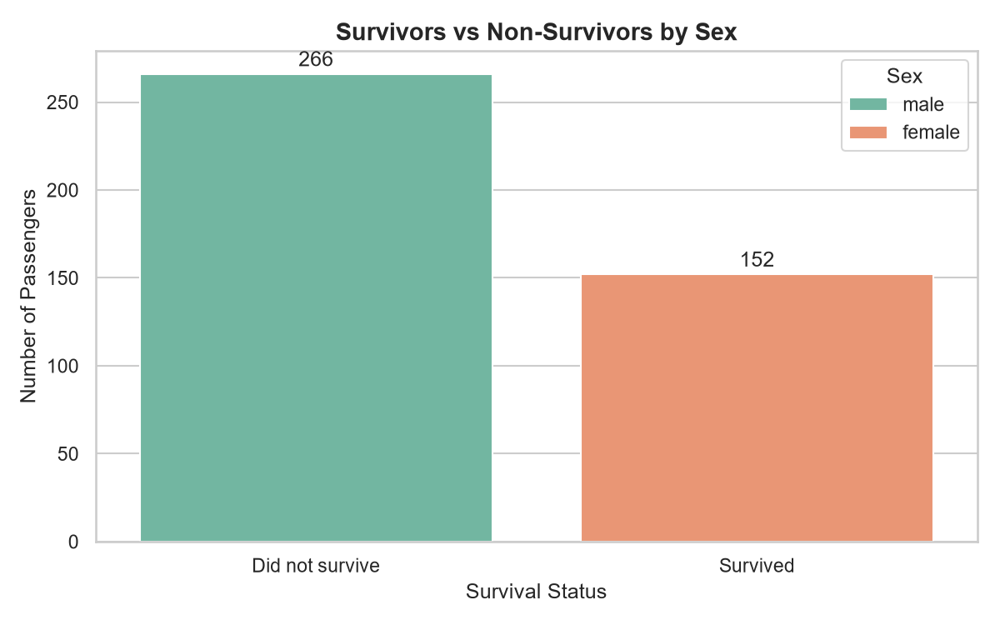
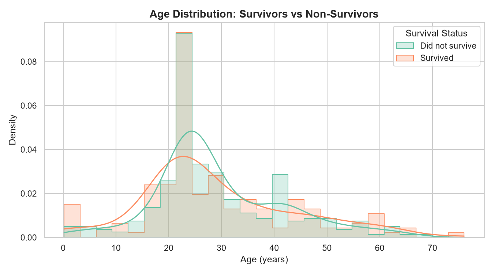
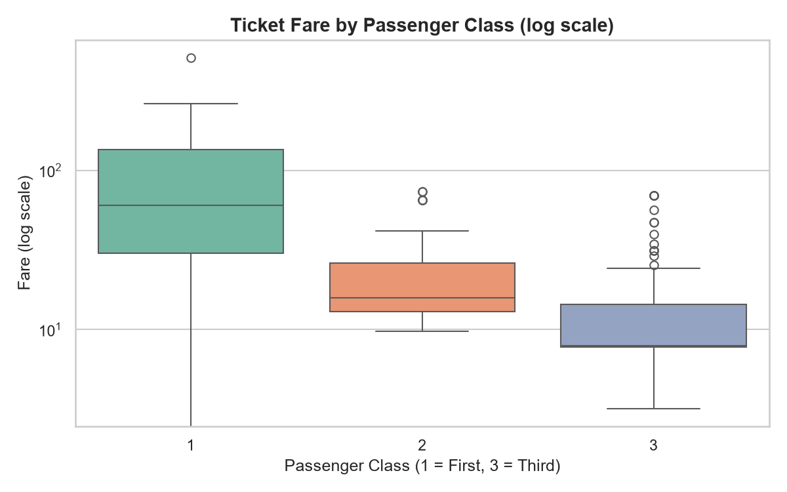
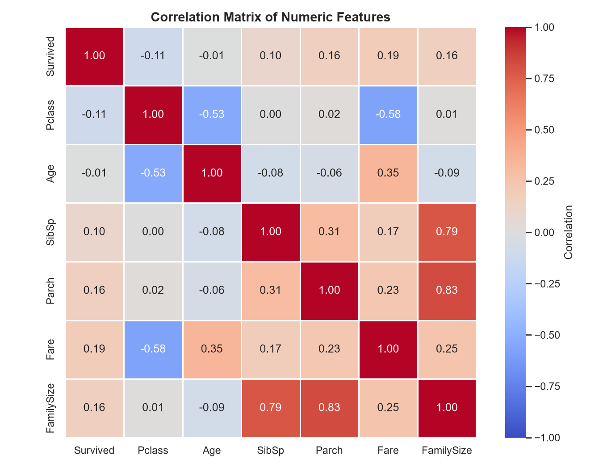

# Titanic Data Analysis

An end-to-end exploratory data analysis (EDA) of Titanic passenger data in Python. The project loads and inspects the data, cleans missing values, engineers a family-size feature, and uses visualizations to explore how sex, age, ticket class and fare relate to survival.

## Overview

- **Goal:** Understand the structure of the passenger data and explore the relationships between passenger characteristics and survival.
- **Dataset:** `Titanic.csv` (418 passengers).
- **Language and libraries:** Python, Pandas, NumPy, Matplotlib, Seaborn.

## Dataset

| Column | Description |
| --- | --- |
| `PassengerId` | Sequential passenger ID |
| `Survived` | Survival status (0 = did not survive, 1 = survived) |
| `Pclass` | Ticket class (1 = first, 2 = second, 3 = third) |
| `Name` | Passenger name |
| `Sex` | Passenger sex |
| `Age` | Age in years |
| `SibSp` | Number of siblings or spouses aboard |
| `Parch` | Number of parents or children aboard |
| `Ticket` | Ticket number |
| `Fare` | Ticket fare |
| `Cabin` | Cabin number |
| `Embarked` | Port of embarkation |

## Workflow

**1. Data loading and exploration**
Load the CSV, then inspect the first rows, the shape, the data types and the descriptive statistics.

**2. Data cleaning and preprocessing**
- Reported the missing values in each column before cleaning.
- Filled missing `Age` values with the **median of each Sex and Pclass group**, which is more accurate than a single value for everyone and is not affected by outliers.
- Filled the missing `Fare` value with the median fare of the passenger's ticket class.
- Filled missing `Embarked` values with the most frequent value (if any were missing).
- Dropped `Cabin`, because most of its values were missing and filling them would have meant guessing.
- Created a new `FamilySize` feature: `SibSp + Parch + 1`.

**3. Exploratory analysis**
The script calculates and prints:
- the overall survival rate,
- survival by sex,
- survival by ticket class,
- the average fare per ticket class,
- survival by sex and ticket class combined.

**4. Visualization**
Four charts are generated and saved to the `figures/` folder.

## Visualizations

### Survivors vs non-survivors by sex


### Age distribution: survivors vs non-survivors


### Ticket fare by passenger class (log scale)


### Correlation matrix of numeric features


## Key observations

- **Fare and class:** Ticket fares drop sharply from first to third class. First class has the widest spread, and third class has many high-fare outliers.
- **Correlations:** Fare and ticket class are negatively correlated (-0.58). Age and ticket class are also negatively correlated (-0.53), so first-class passengers tend to be older. Age and fare are positively correlated (0.35).
- **Family size:** `FamilySize` is strongly correlated with `SibSp` (0.79) and `Parch` (0.83), as expected, since it is built from them.
- **Age:** Survivors and non-survivors both peak in the early twenties. Survivors show a small bump among very young children.

## Data note

In this file, the `Survived` column lines up exactly with `Sex`: every passenger who did not survive is male and every survivor is female. Because of this, survival-related results (including the correlations with `Survived`) describe this file and should not be read as historical findings. A natural next step is to repeat the analysis on a dataset with the full set of original survival records, such as the 891-passenger Kaggle training set.

## Project structure

```
titanic-data-analysis/
├── Titanic.csv            # Input data
├── titanic_analysis.py    # Full analysis script
└── figures/               # Generated charts
```

## How to run

1. Install the requirements:

   ```bash
   pip install pandas numpy matplotlib seaborn
   ```

2. Run the script from the project folder. It looks for `Titanic.csv` next to the script:

   ```bash
   python titanic_analysis.py
   ```

   Or pass the path to a CSV file:

   ```bash
   python titanic_analysis.py path/to/file.csv
   ```

3. The charts are saved in the `figures/` folder.

## Skills demonstrated

Data cleaning and preprocessing, handling missing values with group-based imputation, feature engineering, exploratory data analysis, and data visualization with Matplotlib and Seaborn.

## Author

**Nirmen Mohamed Soltan**
Data Analyst and Data Scientist | Computer Science student, Menoufia University

[GitHub](https://github.com/nirmensoltan-rgb) · [LinkedIn](https://www.linkedin.com/in/nirmeen-soltan-30b81839b) · nirmensoltan@gmail.com
